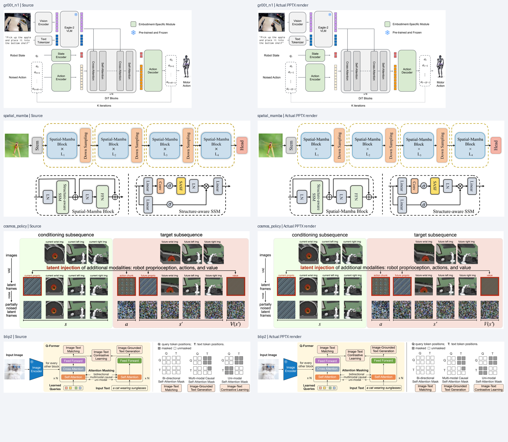
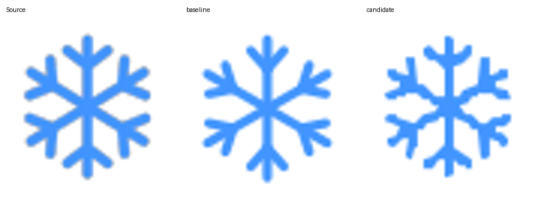

# 形状、图标与颜色细节重测 · 2026-10-10

本轮重建 **四张已有的完整复杂论文图**，沿用原有源图和场景，加入本轮改进并重新导出实际 PPTX。属于已知案例的修复与回归，不是四次盲测新重建。

| 案例 | 本轮检查 / 修复 | 下载 |
| --- | --- | --- |
| GR00T N1 · Figure 3 | 雪花从 18 条线改为一个原生凹形轮廓；14 个 token 修正为源图紫色；单独移动、改色并检查周围对象 | [PPTX](gr00t_n1/editable.pptx) · [场景](gr00t_n1/scene.resolved.json) · [实际渲染](gr00t_n1/actual.png) |
| Spatial-Mamba · Figure 4 | 凸形模块、圆角、虚线、箭头、旋转标签、分支与算子位置 | [PPTX](spatial_mamba/editable.pptx) · [场景](spatial_mamba/scene.resolved.json) · [实际渲染](spatial_mamba/actual.png) |
| Cosmos Policy · Figure 2 | 浅色分区、叠放照片、latent/noise 图块、红色描边及公式位置 | [PPTX](cosmos_policy/editable.pptx) · [场景](cosmos_policy/scene.resolved.json) · [实际渲染](cosmos_policy/actual.png) |
| BLIP-2 · Figure 2 | 编码器蓝色按源图修正；矩阵小格、mask、虚线和模块层级；低分辨率雪花保留为独立图片 | [PPTX](blip2/editable.pptx) · [场景](blip2/scene.resolved.json) · [实际渲染](blip2/actual.png) |

每个目录包含 portable scene/素材、SVG、PPTX、实际 PDF/PNG、字体信息及 validation.json；`index.json` 记录源码版本、源图/产物哈希和检查范围。整页对照为展示缩略图；局部指标使用源图坐标的 PDF 直接栅格化，仅裁去取整产生的画布末行，没有图像缩放或配准。

GR00T 图标在同一 59×60 ROI、同色掩码容差 64 下，IoU 从 **0.6713 → 0.9270**，外缘差异由 `[0,0,0,1]` 改为 `[0,0,0,0]`。这是该局部指标，不是全图准确率。新图标是一个 130 顶点的原生自由形状；[移动并改为橙色的实际渲染](gr00t_n1/edit-demo/actual.png)、[编辑文件](gr00t_n1/edit-demo/editable.pptx) 和 [编辑审计](gr00t_n1/edit-audit.json) 表明其他 143 个叶对象 XML 保持一致。

GR00T 与 BLIP-2 的旧配色均被默认 ΔEOK 检查拦截；修正使用源图明确 ROI 的测量值，阈值保持原值。四个最终文件均为 `review`，合计 129 个颜色抽样没有失败；稀疏区域检查不能替代整体视觉复核。GR00T 和 BLIP-2 仍有文字宽度复核提示。字体没有嵌入，PowerPoint/WPS 的实际兼容性需要分别验证。

原论文版权/许可与改动说明在每个目录的 ATTRIBUTION.md 中；本轮未提取 PDF 原始文字/矢量坐标或作者绘图代码。运行时代码与论文图的许可证分别遵循各自声明。
